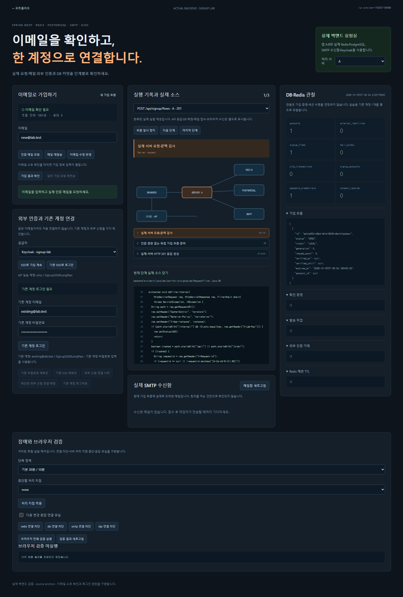
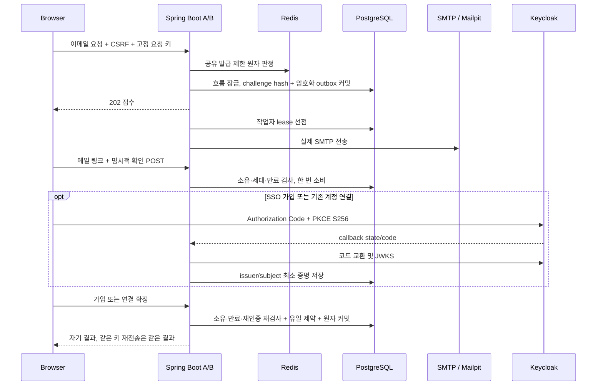

# Spring Boot Signup Lab

이메일 소유 확인부터 중복 가입 방지, 실제 OIDC 가입과 명시적 계정 연결까지 다루는 독립 실험실입니다. 브라우저 조작이 Spring Boot A·B, PostgreSQL, Redis, SMTP 수신함, Keycloak을 실제로 통과합니다. 처리 기록의 파일·행·SHA-256과 실제 소스 발췌를 함께 볼 수 있습니다.



## 실행

검증한 환경은 Windows x64, PowerShell 7, Java 21, Node 24, Git/OpenSSL입니다. 앱은 Java 21을 사용하며 Keycloak 26.8.1용 JDK 25는 프로젝트 `.runtime`에만 내려받습니다. 전역 Java 설정을 변경하지 않습니다. 최초 실행에는 바이너리 다운로드 시간이 필요합니다. 다운로드 SHA-256은 설치 스크립트에 고정되어 있습니다.

```powershell
npm ci
npx playwright install chromium
.\scripts\start-local.ps1
```

[실제 실험실](https://localhost:8470)을 엽니다. 프로젝트 전용 자체 서명 인증서이므로 로컬 브라우저에서 해당 인증서를 허용해야 합니다. 자동 브라우저 검증의 인증서 예외는 이 로컬 실험 출처에만 적용됩니다.

```powershell
# 다른 PowerShell에서, 위 서버를 실행한 상태로 수행
npm run test:backend
npm run test:browser
# 화면의 실행 버튼과 실패/실행/통과 상태까지 검증하며 전체 50개 실행
node scripts/run-browser-ui.mjs
npm run check:coverage
npm run test:preview

# 종료: 해당 프로젝트가 소유한 프로세스만 종료하고 DB 파일 유지
.\scripts\stop-local.ps1
# 앱/게이트웨이만 종료할 때
.\scripts\stop-local.ps1 -KeepInfra
```

장애 검사는 공유 TCP 경로와 실제 앱 프로세스를 제어하므로 여러 테스트 명령을 동시에 실행하지 않습니다. `start-local.ps1`을 다시 실행하면 보존한 데이터와 동일한 런타임 키를 사용합니다. 기본 fixture는 실행 ID마다 `existing@lab.test` / `Signup!2026LongPass`입니다. 외부 IdP 사용자 `alice`, `match`, `unverified`, `noemail`, `other`도 실험용 같은 비밀번호를 사용합니다. 실제 개인 이메일이나 비밀번호를 입력하지 않는 로컬 학습 환경입니다.

## 화면과 처리

- **서비스:** 이메일 요청 → 실제 메일 링크 → 명시적 확인 → 비밀번호·동의 → 가입 확정. 가입만으로 로그인하지 않습니다. 기존 계정의 로그인·재확인·신원 연결은 별도입니다.
- **메일함:** Mailpit이 실제 SMTP로 접수한 메일입니다. 인터넷 메일함의 도착·읽음·스팸 판정까지 검증한 것은 아닙니다. 링크 GET은 증명을 소비하지 않습니다.
- **흐름·소스:** 완료된 실제 서버 이벤트를 재생합니다. 추정 중간 상태를 성공으로 채우지 않습니다. 각 단계의 Java 또는 게이트웨이 소스와 파일 해시를 표시합니다.
- **데이터:** PostgreSQL의 행 수·증명 세대·outbox lease와 Redis 제한 TTL을 읽습니다. 관찰 API는 세션이나 증명을 갱신하지 않습니다.
- **검증:** 단축 정책, DB 커밋 경계 실패, 실제 TCP 차단, 앱 종료·재시작, Playwright 전체 실행과 결과를 제공합니다. 실험용 제어 API는 루프백 게이트웨이 안에서만 사용합니다.



## 정합성과 확장 지점

이메일 비교는 trim·도메인 IDNA·소문자 정책을 사용하며 점·플러스 별칭은 제거하지 않습니다. 외부 신원은 `(realm_id, issuer, subject)`로 식별합니다. 공급자의 이메일이 같아도 기존 계정에 자동 연결하지 않습니다. 공급자별 이메일 신뢰 정책을 명시적으로 켠 경우만 자체 확인을 생략합니다.

DB 트랜잭션이 계정·이메일·Argon2id 자격정보·동의·완료 결과를 함께 확정합니다. 서로 다른 흐름의 경쟁은 DB 유일 제약이 결정하며 패자의 전체 작업을 롤백합니다. 멱등 키의 입력 일치는 목적별 HMAC으로 확인하고 비밀번호 원문이나 빠른 비밀번호 해시를 보관하지 않습니다.

SMTP는 적어도 한 번 시도합니다. 접수 응답을 잃으면 같은 링크의 메일이 중복 도착할 수 있습니다. DB의 한 번 소비와 가입 제약이 계정 중복을 막습니다. 발송 대기 중 필요한 원문 링크는 AEAD로 암호화하고 종결·만료 시 제거합니다. Redis는 제한·브라우저 문맥용이며 계정과 증명 완료 여부의 최종 권한은 DB에 있습니다.

Keycloak의 실제 code/PKCE, state/nonce, JWT 서명·issuer·audience·azp·만료 검증을 거칩니다. 토큰 원문은 보존하지 않습니다. 신원 연결은 기존 계정 로그인과 최근 재확인, 외부 증명, 마지막 명시적 연결 POST까지 요구합니다. `main`과 `team` 공급자를 분리하고 client 및 공급자 정의를 추가할 수 있습니다. 두 서비스가 각자 쿠키를 가진 RP 간 SSO(T01~T04)는 원본 설계의 후속 범위입니다.

## 포트와 구성

| 구성 | 직접 포트 | 앱이 사용하는 장애 실험 경로 |
|---|---:|---:|
| HTTPS 게이트웨이 | 8470 | 브라우저 진입 |
| Spring Boot A / B | 8471 / 8472 | 게이트웨이 프록시 |
| PostgreSQL 17.11 | 55442 | 55443 |
| Redis 7.4.3 | 56479 | 56480 |
| Mailpit SMTP / HTTP | 11025 / 18025 | 11026 (SMTP) |
| Keycloak 26.8.1 | 18444 | 18445 (서버), 18443 (브라우저 HTTPS) |

기본 흐름은 30분, 링크·확인 증명 10분, 재발송 간격 60초, 최근 인증 5분입니다. Redis의 이메일 제한은 시간당 5회, IP는 10분 20회, DB의 흐름별 메일 발급은 최대 3회입니다. 짧은 정책과 실제 만료 검사용 정책은 `Policy.java`에 명시되어 있습니다. 브라우저 문맥은 30분 고정 TTL이며 재인증은 기존 인증의 절대 만료를 연장하지 않습니다.

DB/메일/IdP/비밀키는 기존 로그인·게시판·채팅 프로젝트와 공유하지 않습니다. `.runtime`, 비밀키·인증서·메일 DB·실행 로그·원본 브라우저 오류 자료는 Git에서 제외합니다. 고정 fixture와 실험용 관리 엔드포인트가 있으므로 그대로 인터넷에 공개하는 운영 배포 구성이 아닙니다.

## 검증 근거와 소스

[요구사항 50개와 실제 결과](docs/verification/COVERAGE.md), [브라우저 결과](docs/verification/browser-summary.json), [실제 SQL 저장 내용 검사](docs/verification/backend-summary.json), [실행기 진단](docs/verification/test-runner.json), [원본 상세설계](docs/DESIGN.md), [구현 순서](docs/IMPLEMENTATION-PLAN.md).

공개 [포트폴리오 체험](https://seonyoungyoo16.github.io/portfolio/#project/signup)은 정적 시뮬레이션입니다. 공개 화면의 상태와 테스트 배지는 로컬 실제 백엔드 실행 기록과 분리되며, 고정 소스 커밋과 위 검증 근거로 연결됩니다. 부하 테스트나 운영 가용성을 증명하는 결과는 포함하지 않습니다.
