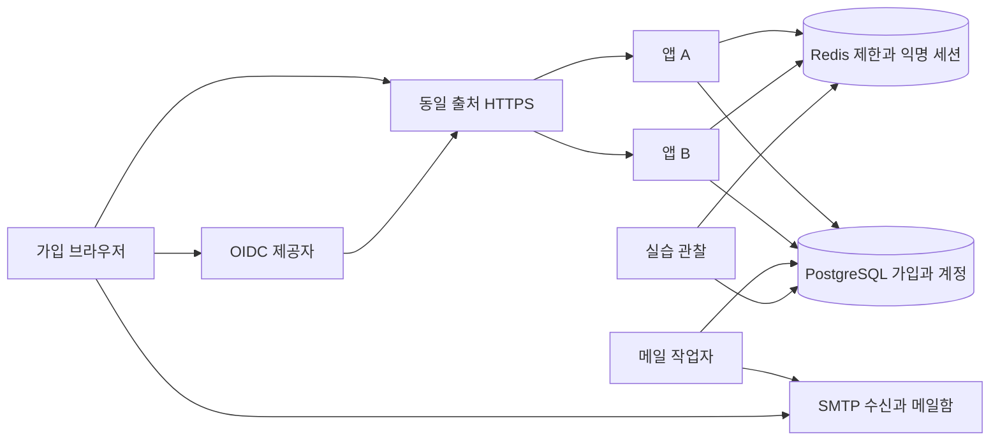

# 회원가입과 이메일 인증 및 SSO 확장 상세설계

기준일 2026-10-18 KST. 구현 전 설계안. 아래 시간·횟수·기술 구성은 이 실험실의 제안값이다. 브라우저 시나리오는 모두 미실행이다.

이 프로젝트는 회원가입 버튼을 누른 뒤 이메일 확인, 계정 생성, 중복 요청, 외부 인증 계정 연결이 어떤 순서로 확정되는지 직접 확인하는 독립 실험실이다. 기존 로그인 프로젝트와 같이 실제 서비스 화면, 실행 기록 재생, Redis·DB 관찰, 실제 소스 연결, 브라우저 검증을 함께 제공한다.

기본 가입 순서는 이메일 입력 → 실제 SMTP 접수 → 메일의 확인 링크 열기 → 명시적으로 이메일 확인 → 비밀번호·약관 입력 → 계정 생성이다. 이메일 소유 확인과 계정 생성은 별도 단계이며, 가입 완료가 곧 로그인 성공을 뜻하지 않는다. 애플리케이션 소스, DDL, 설정, HTML 화면, 테스트 코드는 이 단계에서 작성하지 않는다.

## 1 범위와 핵심 결정

| 항목 | 첫 구현 범위 |
|---|---|
| 일반 가입 | 이메일 소유 확인, 비밀번호, 표시 이름, 필수·선택 동의, 가입 결과 복구 |
| 이메일 | 실제 SMTP 수신 도구에서 메일 확인, 재발송, 만료, 이전 링크 무효화, 잘못된 브라우저 처리 |
| 중복 | 같은 이메일의 동시 가입, 버튼 연타, 같은 요청 재전송, 응답 유실, 일반·SSO 가입 경쟁 |
| SSO 기반 | 실제 로컬 OIDC 제공자를 사용한 신규 가입과 기존 계정에 대한 명시적 연결 |
| SSO 확장 | 공급자 추가 구조, issuer 분리, 외부 이메일 변경, 두 서비스 SSO 확장 시나리오 |
| 관찰 | 요청별 처리 단계, DB 트랜잭션, 메일 작업, Redis 제한, 소스 파일·행 연결 |
| 검증 | 실제 DB·Redis·SMTP·OIDC와 분리된 브라우저 컨텍스트를 사용하는 기능별 검증 |

첫 구현의 외부 인증은 Keycloak을 실제 로컬 OIDC 서버로 사용한다. Google·Microsoft 운영 계정 연동, SAML, 기업 조직 초대, 계정 병합, 비밀번호 재설정, 이메일 변경, 운영 메일 도달률 검증은 후속 범위다. 실제 여러 서비스의 SSO는 두 번째 RP를 추가하는 확장 단계에서 별도로 검증한다.

## 2 반드시 지킬 규칙

| 규칙 | 보장 기준 |
|---|---|
| 이메일 소유 확인 | 검증된 이메일과 현재 가입 흐름에 묶인 증명이 있어야 일반 계정을 생성한다. |
| 계정 생성 | DB 주 저장소의 트랜잭션 커밋이 완료된 계정만 가입 완료로 표시한다. |
| 이메일 중복 | 서비스 영역 안에서 정규화한 이메일 하나에 계정 하나만 배정한다. |
| 외부 인증 중복 | 서비스 영역과 issuer·subject 조합 하나는 계정 하나에만 연결한다. |
| 재전송 | 동일 가입 흐름의 같은 멱등 키와 같은 입력은 최초 확정 결과를 반환한다. |
| 인증과 가입 | 이메일 확인만으로 로그인·비밀번호 변경·기존 계정 연결 권한을 부여하지 않는다. |
| SSO 연결 | 같은 이메일이라는 이유로 기존 계정을 자동 연결하거나 합치지 않는다. |
| 저장소 장애 | 확인 불가와 실패·미가입을 구분한다. 결과 불명 상태에서 새 가입 요청을 만들지 않는다. |
| 관찰 | 화면 관찰이 링크·가입 흐름·인증 증명의 만료를 연장하지 않는다. |
| 민감정보 | 비밀번호, 확인 토큰, 쿠키, 인가 코드, PKCE verifier, ID Token 원문을 실행 기록에 남기지 않는다. |

DB 유일 제약이 최종 중복 방지 기준이다. Redis 잠금이나 가입 전 중복 조회는 이 제약을 대체하지 않는다. PostgreSQL은 유일 인덱스에서 동일한 키의 중복을 거부한다. [PostgreSQL 17 유일 인덱스](https://www.postgresql.org/docs/17/indexes-unique.html)

동일 이메일은 아래 비교 정책으로 같은 키가 되는 주소를 뜻한다. 서로 다른 별칭 주소를 같은 실제 사람으로 알아내는 기능은 제공하지 않는다.

## 3 실행 구성과 기존 로그인 프로젝트의 관계

| 영역 | 선택안과 역할 |
|---|---|
| 화면 | React·TypeScript. 가입 서비스, 처리 기록, 데이터, 검증 탭 |
| 서버 | Java 21·Spring Boot·Spring Security. 입력·CSRF·비밀번호·OIDC 검증 |
| DB | PostgreSQL 주 저장소. 가입 흐름·증명·계정·유일 제약·멱등 결과·메일 작업 |
| Redis | A·B 공통 익명 CSRF 세션, 요청 제한, 짧은 관찰 캐시. 계정과 이메일 증명의 최종 기준은 DB |
| 메일 | Mailpit. 실제 SMTP 메시지를 수신하고 브라우저에서 확인하는 로컬 메일함 |
| 외부 인증 | Keycloak. 실제 리다이렉트·코드 교환·서명 검증을 수행하는 OIDC 제공자 |
| 검증 | Playwright, DB·Redis 직접 관찰, SMTP 수신 확인, 처리 지점 차단과 실제 프로세스 재시작 |

예정 독립 프로젝트 이름은 springboot-signup-lab이다. 로컬 HTTPS 진입 포트는 8470, 앱 A·B는 8471·8472를 제안하며 구현 착수 때 충돌을 확인한다. 기존 로그인 실험실의 포트·DB·Redis 키를 공유하지 않는다. 저장소·메일·IdP는 프로젝트 소유 프로세스 또는 컨테이너로 실행하고 세부 버전은 착수 때 고정한다.

Mailpit의 SMTP 수신은 수신함에서 실제 메시지를 확인하는 근거다. SMTP 접수와 인터넷 메일함 도착·읽음은 다른 상태로 표시한다. [Mailpit 기능](https://mailpit.axllent.org/docs/)

가입과 로그인은 같은 accountId를 기준으로 연계할 수 있도록 계약을 맞춘다. 다만 현재 로그인 구현은 users.password_hash가 필수이고, 이메일 형태의 login_id 길이와 비교 정책도 별도다. 비밀번호 없는 SSO 계정을 이 테이블에 억지로 넣거나 기존 DB를 바로 공유하지 않는다.

새 설계는 계정, 이메일, 비밀번호 자격정보, 외부 인증을 분리한다. 후속 통합에서 로그인 조회 어댑터·비밀번호 인코더·마이그레이션을 함께 변경한다. 가입 직후의 실제 자격정보 확인과 연결 관리에는 작은 인증 어댑터를 두고 기존 로그인 설계의 세션·재확인 정책을 사용한다. 전체 로그인·유지 기능을 회원가입 프로젝트 안에서 다시 확장하지 않는다.

포트폴리오의 정적 체험은 설계 규칙의 시뮬레이션으로 표시한다. 실제 백엔드 검증은 독립 실험실의 실행 결과로 연결하며 두 결과를 섞지 않는다.

## 4 화면 구성

데스크톱은 가입 서비스, 처리 흐름·소스, 데이터 관찰의 세 영역으로 구성한다. 하단에는 실제 테스트 결과를 둔다. 모바일은 서비스·메일함·흐름·데이터·검증 탭을 사용하며 선택한 패널만 표시한다.

| 화면 | 입력과 표시 | 주요 동작과 예외 |
|---|---|---|
| 가입 시작 | 이메일, 이메일로 계속, OIDC 공급자로 계속, 로그인으로 이동 | 형식 검사만 먼저 한다. 미인증 상태의 계정 존재 여부 조회 버튼은 제공하지 않는다. |
| 이메일 확인 대기 | 마스킹 이메일, 요청 접수 시각, 링크 유효 시간, 재발송 가능 시간 | 메일 요청 202를 수신 완료로 표시하지 않는다. 이메일 수정과 재발송을 제공한다. |
| 실습 메일함 | 해당 실행에 도착한 메일, SMTP 수신 시각, 확인 링크 열기 | 실제 수신한 메일에서 이동한다. 앱의 관찰 JSON에서 토큰을 꺼내 인증하지 않는다. |
| 이메일 확인 | 대상 이메일, 유효 상태, 이메일 확인 버튼 | 링크 GET만으로 인증하지 않는다. 같은 가입 브라우저에서 버튼을 눌러 POST한다. |
| 다른 브라우저 안내 | 가입을 시작한 브라우저에서 열기, 현재 브라우저에서 새로 시작 | 잘못된 프로필에서는 토큰을 소비하거나 계정을 생성하지 않는다. |
| 가입 정보 | 확인한 이메일 읽기 전용, 표시 이름, 비밀번호·확인, 필수·선택 동의 | 비밀번호를 가입 시작 때 수집하지 않는다. 이메일을 바꾸면 확인 증명을 무효화한다. |
| 가입 처리 중 | 요청 식별자, 결과 확인 중, 같은 요청 결과 확인 | 더블 클릭을 막되 서버의 멱등 처리를 별도로 수행한다. 불명 결과에 새 키로 재가입하지 않는다. |
| 가입 완료 | 완료 시각, 로그인으로 이동, 처리 흐름 보기 | 계정 생성과 로그인 세션 발급을 구분한다. 브라우저 복구에도 같은 완료 결과를 보여준다. |
| 이미 가입한 주소 | 로그인으로 이동, 기존 계정으로 로그인 후 외부 인증 연결 | 이메일 소유 확인 뒤에만 안내한다. 기존 비밀번호나 계정 상태를 변경하지 않는다. |
| 외부 인증 진행 | 공급자, 외부 인증으로 이동, 취소 | 실제 IdP 화면으로 이동하고 취소·만료·오류를 구분한다. |
| 외부 인증 후 가입 | 확인한 공급자, 제공 이메일의 검증 상태, 추가 이메일 확인, 동의 | 기존 이메일과 같아도 자동 연결하지 않는다. 미완료 증명은 가입 완료 버튼을 잠근다. |
| 계정 연결 관리 | 현재 계정, 연결된 로그인 방식, 공급자 연결, 최근 인증 상태 | 기존 계정 재인증 → 새 외부 신원 확인 → 명시적 연결 확인 순서다. |
| 장애·결과 불명 | 실패 지점, 데이터 확인 가능 여부, 결과 조회·동일 요청 재시도 | 메일 지연, Redis 장애, DB 장애, IdP 장애를 각각 설명한다. |

실습 메일함은 실행 ID로 격리하고 로컬에서만 제공한다. Mailpit의 전체 관리 화면이나 모든 사용자의 메일을 공개 포트폴리오에 노출하지 않는다. 메일 HTML은 외부 이미지·스크립트를 실행하지 않고 확인 링크의 출처도 제한한다.

### 처리 흐름과 소스 패널

요청 검사 → 제한 확인 → 가입 흐름 잠금 → DB 커밋 → 메일 작업 → SMTP 접수 → 이메일 검증 → 최종 계정 커밋의 해당 단계를 표시한다. SSO에서는 리다이렉트 → 코드 교환 → 토큰 검증 → 신원 판정 → 가입 또는 연결로 분기한다.

설명 미리보기에는 설계 예시, 실제 실행 후에는 완료된 실행 재생을 표시한다. 단계 선택, 일시 정지, 다음 단계, 마지막 이동, 동일 실행 다시 보기를 제공한다. DB 확정·메일 접수·브라우저 수신·테스트 통과를 각각 따로 표시한다.

실제 소스 연결은 구현 후 고정 커밋에서 추출한다. 이메일 요청, 발송 작업자, 이메일 확인, 계정 생성, OIDC 검증, 신원 연결의 코드 조각·파일·행·해시를 각 단계에 연결한다. 현재 문서의 역할 이름은 설계용이며 아직 존재하는 소스라고 표시하지 않는다.

## 5 정책과 만료

| 항목 | 제안 기본값 | 기준 |
|---|---:|---|
| 가입 흐름 | 최초 30분 | 활동·재발송으로 연장하지 않는다. |
| 이메일 확인 링크 | 발급 후 10분 | 현재 흐름·이메일·발급 세대와 일치해야 한다. |
| 확인 후 가입 가능 시간 | 확인 후 10분 | 가입 흐름 전체 종료도 넘지 못한다. |
| 메일 재발송 간격 | 60초 | DB 흐름의 마지막 발급 시각과 Redis 제한을 함께 확인한다. |
| 흐름별 메일 발급 | 최대 3회 | 동일 멱등 키의 재조회는 추가 발급하지 않는다. |
| 이메일별 발급 제한 | 1시간 5회 | 정규화 이메일의 HMAC 키로 Redis에서 제한한다. |
| IP별 발급 제한 | 10분 20회 | 프록시가 보장한 IP만 사용한다. 임의 헤더를 신뢰하지 않는다. |
| 링크 확인 실패 제한 | 흐름별 10분 5회 | 토큰 추측·무작위 요청의 자원 사용을 제한한다. |
| OIDC 거래 | 5분 | state·nonce·PKCE·목적·브라우저를 한 거래에 묶는다. |
| 외부 인증 후 가입·연결 증명 | 검증 후 5분 | 가입 흐름·연결 요청의 종료도 넘지 못한다. |
| 기존 계정의 최근 인증 | 5분 | 기존 로그인 수단을 실제로 다시 확인한 결과가 필요하다. |
| 멱등 결과 보관 | 24시간 | 보관 기간이 가입 쿠키의 조회 권한을 연장하지 않는다. |
| 메일 시도 | 최대 5회 | 최초 시도 후 5·30·120·300초 간격. 링크 만료 뒤에는 발송하지 않는다. |
| 메일 작업 lease | 20초 | 작업자 중단 후 다른 작업자가 회수한다. SMTP 시도 제한은 5초부터 조정한다. |

시간은 서버가 판정한다. DB 잠금 뒤 마지막 조건 검사에서 만료 여부를 다시 확인하고, 장시간 대기한 트랜잭션의 시작 시각을 현재 시각처럼 사용하지 않는다. 만료 판정 경계와 재현 시각을 기록한다. 이미 유효성 검사를 통과한 트랜잭션의 아주 짧은 커밋 지연을 브라우저 시계만으로 실패라고 판단하지 않는다.

단축 실습 정책은 흐름 60초·링크 20초·확인 후 20초·재발송 5초를 제안한다. 기본 정책과 단축 정책은 실행별로 고정하며 실제 백엔드 테스트는 실제 경과 시간을 사용한다. Pages 체험의 가상 시계와 구분한다.

### 이메일 비교와 비밀번호

이메일은 표시 원본과 비교용 키를 분리한다. 외부 공백을 제거하고 도메인은 IDNA 처리 후 소문자로 비교한다. 첫 버전은 ASCII local-part에 한정하고 서비스 정책상 local-part도 대소문자를 구분하지 않는다. 이는 모든 SMTP 주소의 동일성에 대한 주장과 다르다. 이 정책으로 충돌하는 두 주소를 별도 계정으로 만들지 않으며 이후 로그인·복구·연결에도 같은 버전의 비교 정책을 사용한다.

Gmail의 점 제거·플러스 태그 제거처럼 공급자별 별칭 추정을 전역 적용하지 않는다. 비교 키를 배포 후 바꿀 때는 기존 데이터의 충돌 검토와 마이그레이션이 필요하다. [OWASP 이메일 정규화와 소유 확인](https://cheatsheetseries.owasp.org/cheatsheets/Email_Validation_and_Verification_Cheat_Sheet.html)

비밀번호는 MFA 없는 가입의 시작 정책으로 15자 이상·최대 128자, 추가 UTF-8 바이트 상한 1024를 제안한다. 공백·한글을 허용하고 임의 trim·정규화·조용한 잘라내기를 하지 않는다. 표시 이름은 로그인 식별자가 아니므로 다른 사람과 중복을 허용한다.

비밀번호는 알고리즘 식별자를 포함한 Argon2id 해시로 저장한다. 최소 시작 매개변수는 메모리 19MiB·반복 2·병렬도 1로 두고 실제 장비에서 비용과 동시 실행 상한을 검증해 조정한다. 기존 BCrypt 계정은 후속 로그인 어댑터가 함께 검증할 수 있도록 설계한다. 알려진 취약 비밀번호 검사는 로컬 정책 목록으로 시작하고 실제 비밀번호를 외부 서비스에 보내지 않는다. [OWASP 비밀번호 저장](https://cheatsheetseries.owasp.org/cheatsheets/Password_Storage_Cheat_Sheet.html)

### 가입 쿠키와 확인 링크

가입 쿠키는 __Host-signup_flow를 제안한다. 충분히 무작위인 256비트 비밀값이며 Secure·HttpOnly·SameSite=Lax·Path=/·Domain 없음으로 발급한다. DB에는 해시만 보관한다. 가입 흐름의 조회·변경 권한일 뿐 로그인 권한은 없다. 익명 CSRF 세션은 별도로 유지하고 상태 변경 POST에 검증한다.

이메일 링크의 비밀값도 무작위 256비트로 만든다. 브라우저 URL fragment로 전달하고 확인 페이지가 메모리로 읽은 뒤 주소 표시에서 제거한다. 페이지 GET이나 메일 보안 스캐너의 접근은 인증 상태를 바꾸지 않는다. 사용자가 확인 버튼을 눌렀을 때만 비밀값을 POST하며 가입 쿠키와 현재 세대를 함께 검증한다.

확인 페이지에는 no-store·no-referrer·제한된 CSP를 적용하고 제3자 분석 스크립트를 넣지 않는다. 토큰을 localStorage·일반 로그·URL query에 저장하지 않는다. 확인 URL은 고정된 설정에서 생성하고 요청의 Host 값으로 조립하지 않는다.

다른 브라우저에서는 링크를 소비하지 않고 처음 브라우저에서 열거나 새 흐름을 시작하도록 안내한다. 두 탭은 같은 가입 쿠키를 공유한다. 여러 독립 가입자를 시험할 때는 서로 다른 브라우저 컨텍스트를 사용한다.

## 6 DB와 Redis의 저장 책임

각 유일 키의 서비스 영역은 realm_id로 표현한다. 운영 단일 서비스는 고정 영역, 실험실은 실행별 영역을 사용한다. 다른 실행 사이의 중복 허용은 테스트 격리를 위한 것이며 운영 중복 정책과 혼동하지 않는다.

| 논리 테이블 | 주요 항목과 제약 | 책임 |
|---|---|---|
| accounts | accountId, realmId, status, authVersion, createdAt | 영속 사용자 식별자. 가입 경로와 무관하다. |
| account_emails | accountId, originalEmail, emailKey, verifiedAt, proofSource, primary 여부 | UNIQUE(realmId, emailKey). 정지·보존 중 계정도 주소를 함부로 재배정하지 않는다. |
| password_credentials | accountId, algorithm, encodedHash, updatedAt | 계정당 비밀번호 0개 또는 1개. SSO 전용 계정은 행이 없다. |
| external_identities | accountId, issuer, subject, provider 설정 ID, linkedAt | UNIQUE(realmId, issuer, subject). 외부 표시 이메일은 식별키가 아니다. |
| signup_flows | flowId, cookieHash, emailKey, emailGeneration, intent, status, expiresAt, verifiedUntil | 가입 시도와 브라우저 소유권. 미인증 이메일의 독점 예약권은 없다. |
| email_challenges | challengeId, flowId, generation, tokenHash, emailKey, state, expiresAt, consumedAt | 한 번만 사용할 이메일 확인 증명. 이전 세대는 무효다. |
| signup_operation_results | flowId, operation, idempotencyKey, requestHmac, hmacKeyId, outcome, accountId, createdAt | UNIQUE(flowId, operation, idempotencyKey). 확정 결과 재조회·재전송 처리 |
| consent_records | accountId, 목적·약관 버전, 선택값, 동의 시각 | 계정과 같은 커밋에서 동의 근거를 저장한다. |
| mail_outbox | messageId, flowId, generation, payloadCiphertext, keyId, state, leaseUntil, attempts | UNIQUE(flowId, generation, mailType). 커밋한 메일 요청을 비동기로 처리한다. |
| mail_attempts | messageId, 시도 시각, 접수·실패·불명 결과, 오류 분류 | 메일 발송 재시도와 중복 접수의 관찰 근거 |
| oidc_transactions | transactionId, stateHash, nonceHash, verifierCiphertext, keyId, issuer, clientId, intent, ownerFlow 또는 ownerAccount, 상태·만료 | 코드 교환을 한 번 수행하고 검증한 외부 신원을 현재 목적에 묶는다. |
| identity_link_requests | targetAccountId, authVersion, 인증 세션 기록, 최근 인증 시각, providerProof, 상태·만료 | 기존 계정과 외부 신원 양쪽을 확인한 연결 요청 |
| account_audit_events | requestId, realmId, 이벤트, 결과, 주체 가명, 시각 | 민감정보 없는 감사와 실행 기록 |

이는 논리 모델이며 실행용 DDL이 아니다. 계정 이메일과 외부 신원 유일성은 NULL에 기대지 않는 실제 식별키로 강제한다. 실제 사람의 계정 병합은 자동화하지 않는다.

### 상태 전이와 판정

DB 가입 흐름의 수명 상태는 OPEN → COMPLETED 또는 CANCELLED로 둔다. 이메일 확인과 외부 인증은 각자의 증명 기록에서 관리한다. 화면의 가입 가능 여부는 두 증명의 조건과 서버 시각으로 계산하고, READY 같은 화면 상태만 믿고 계정을 생성하지 않는다.

| 표시 상태 | 조건 | 허용 동작 |
|---|---|---|
| 이메일 필요 | OPEN이며 현재 이메일의 유효한 증명 없음 | 메일 요청·확인·이메일 수정 |
| 외부 인증 필요 | OIDC 가입 의도이며 유효한 provider proof 없음 | 해당 공급자의 인증 다시 시작 |
| 가입 정보 입력 가능 | 필요한 증명이 모두 유효하고 기존 이메일 충돌 없음 | 입력·동의·최종 가입. 최종 트랜잭션에서 조건 재검사 |
| 이미 가입한 주소 | 현재 이메일 소유 확인 뒤 기존 계정이 관찰됨 | 기존 방식의 로그인·명시적 연결 또는 주소 변경. 기존 계정 변경 권한 없음 |
| 결과 확인 중 | 제출했지만 커밋 결과를 브라우저가 확인하지 못함 | 같은 흐름·같은 키의 조회와 재시도 |
| 가입 완료 | COMPLETED이며 자기 확정 결과 존재 | 결과 조회·정상 로그인으로 이동. 추가 계정 생성 불가 |
| 흐름 종료 | CANCELLED 또는 전체 expiresAt 경과 | 새 흐름 시작. 이전 증명을 새 흐름에 복사하지 않음 |

이메일 challenge는 ACTIVE → CONSUMED, SUPERSEDED 또는 EXPIRED로 전이한다. 인증 증명만 만료되고 전체 흐름이 살아 있으면 이메일 필요로 돌아가 재발급할 수 있다. 관찰 요청이 상태를 활성화하거나 수명을 연장하지 않는다.

메일 작업은 PENDING → LEASED → SMTP_ACCEPTED 또는 RETRY_WAIT·DELIVERY_UNKNOWN·DEAD·EXPIRED로 구분한다. IdP 거래는 PENDING → EXCHANGING → VERIFIED 또는 FAILED·EXPIRED이며, VERIFIED는 가입·연결 증명이지 계정 생성 완료가 아니다.

| Redis 데이터 | 사용 목적 | Redis가 사라질 때 |
|---|---|---|
| 익명 CSRF·연결 관리 세션 | A·B 공통 브라우저 문맥과 CSRF | 다시 준비하거나 재인증한다. DB 계정·이메일 증명은 사라지지 않는다. |
| IP·이메일 HMAC·흐름별 제한 | 짧은 창의 원자적 허용·거부와 Retry-After | 가용하지 않으면 새 외부 메일 요청·검증·최종 가입을 503으로 중단한다. |
| 관찰 캐시 | 짧은 화면 조회 비용 감소 | 확인 불가·오래된 관찰임을 표시한다. DB 확정을 추정하지 않는다. |

Redis 제한은 Lua 등 원자 연산으로 A·B에 공통 적용한다. 여러 제한 키를 원자적으로 처리하려면 독립 실행과 Redis Cluster의 슬롯 제약을 구분해 구현한다. 첫 구현은 단일 Redis의 두 앱 공유 실험이다. Redis 복구로 사라진 제한 이력이 그대로 보존된다고 보장하지 않으며 DB의 발급 간격·세대·유일성 검사는 계속 적용한다. [Redis 스크립트 실행](https://redis.io/docs/latest/develop/programmability/eval-intro/)

## 7 이메일 가입의 처리 순서

### 7.1 이메일 요청과 재발송

1. 브라우저가 가입 문맥·CSRF를 준비하고 흐름 식별자와 가입 쿠키를 받는다. 준비 자체로 계정이나 이메일 확인 상태가 만들어지지 않는다.
2. 이메일 형식과 길이를 검사하고 비교 키를 만든다. Redis에서 IP·이메일·흐름 제한을 확인한다.
3. DB 트랜잭션에서 흐름을 잠그고 쿠키 소유권·전체 만료·메일 발급 간격·발급 횟수를 재검사한다. 같은 멱등 키의 확정 결과가 있으면 추가 발급 없이 반환한다.
4. 다음 발급 세대와 확인 토큰 해시를 저장한다. 이전 미사용 세대는 SUPERSEDED로 바꾸고 현재 세대에 대한 mail_outbox를 같은 트랜잭션에 저장한다.
5. COMMIT 뒤 202 REQUEST_ACCEPTED를 반환한다. 기존 계정·신규 주소 모두 같은 접수 경로와 외부 응답을 사용한다. 이 시점에 계정은 생성되지 않는다.
6. 작업자가 커밋된 outbox를 lease로 가져온다. DB 잠금을 잡은 채 SMTP를 호출하지 않는다. 만료·이전 세대 여부를 확인하고 SMTP로 보낸다.
7. SMTP 서버의 접수 응답과 실제 실습 메일함의 수신을 별도로 기록한다. 그 결과를 관찰 화면에 표시한다.

계정 존재를 알아내는 별도 공개 API를 만들지 않는다. 신규·기존 이메일 모두 같은 확인 메일을 보내며, 유효한 확인 증명을 제출한 다음에만 이미 가입한 주소임을 안내한다. 같은 응답 문구만으로 모든 시간 기반 추론을 막았다고 주장하지 않고 응답 코드·본문·처리 분기와 지연 차이도 검사한다. [OWASP 가입 오류 응답](https://cheatsheetseries.owasp.org/cheatsheets/Authentication_Cheat_Sheet.html#authentication-and-error-messages)

재발송 무효화의 범위는 같은 가입 흐름 안이다. 공격자가 다른 브라우저에서 같은 이메일로 요청해도 원래 사용자의 흐름과 링크를 무효화하지 않는다. 이메일별 제한은 별도로 적용한다.

### 7.2 비동기 메일에 필요한 비밀값

확인 테이블은 토큰 해시만 저장하지만 비동기 작업자는 링크를 구성할 원문이 필요하다. 따라서 미발송 메일의 링크·수신자·내용은 별도 키의 AEAD 암호문으로 outbox에 저장한다. 키는 저장소·Git·일반 로그에 넣지 않고 실행 환경에서 주입한다. 메시지 ID·흐름·세대를 암호문의 부가 인증 데이터에 묶는다.

작업자만 복호화하고 같은 작업을 재시도할 때 같은 링크를 보낸다. 완료·만료 뒤에는 짧은 정리 유예 후 암호문을 삭제하고 시도 결과만 남긴다. 개인정보 보관 기간의 구체값은 공개 호스팅을 설계할 때 별도 확정한다.

SMTP 접수 직후 작업자가 중단되면 DB에는 접수 기록이 없을 수 있다. 재시도에서 같은 메일이 두 번 도착할 수 있으며 동일 Message-ID도 정확히 한 번 수신을 보장하지 않는다. 메일은 중복 도착 가능, 토큰 사용과 계정 생성은 한 번 확정으로 설계한다. SMTP 응답 유실은 SENT가 아니라 DELIVERY_UNKNOWN으로 기록한다.

### 7.3 링크 확인

1. 사용자가 실제 수신 메일의 링크를 연다. GET은 안내 페이지와 현재 흐름 상태만 제공한다.
2. 사용자가 확인 버튼을 누르면 토큰과 CSRF를 POST한다. 서버는 가입 쿠키의 소유 흐름을 먼저 확인한다.
3. DB에서 흐름과 challenge를 일정한 순서로 잠근다. 이메일 키·현재 세대·토큰 해시·미사용·논리 만료를 재검사한다.
4. 한 트랜잭션에서 challenge를 CONSUMED로 바꾸고 흐름의 이메일 확인 시각·가입 가능한 종료 시각을 저장한다. 소비만 되고 확인 상태가 사라지는 중간 커밋을 만들지 않는다.
5. 같은 흐름의 동일 확인 요청 재전송은 기존 확인 결과를 반환한다. 다른 흐름으로 증명을 옮기거나 다른 이메일에 재사용할 수 없다.
6. 이미 계정이 있는 주소라면 가입 정보 화면 대신 기존 방식의 로그인·연결 안내로 이동한다. 이 이메일 확인만으로 기존 계정의 비밀번호를 설정하거나 연결하지 않는다.

이메일을 수정하면 emailGeneration을 올리고 해당 이메일의 확인 증명을 지운다. 진행 중이던 최종 가입도 잠금 후 새 세대를 재검사한다. 한 번 확인한 옛 이메일을 화면 값만 바꿔 다른 주소의 가입에 사용할 수 없다.

### 7.4 최종 계정 생성

1. 브라우저가 표시 이름·비밀번호·동의 버전과 멱등 키를 제출한다. 키는 한 번의 최종 가입 동작에 고정한다. 비밀번호는 브라우저 메모리와 요청 처리에만 둔다.
2. 소유 흐름의 이미 확정된 동일 요청이면 기존 결과를 반환한다. 입력이 달라진 같은 키는 409 IDEMPOTENCY_KEY_REUSED로 거부한다.
3. Redis에서 자원 사용을 제한하고 비밀번호 정책을 검사한다. 제한된 해시 실행 슬롯에서 Argon2id를 계산한다. 비밀번호 해시 계산 중 DB 행 잠금을 오래 점유하지 않는다.
4. DB 트랜잭션에서 흐름을 잠그고 확인 증명·세대·실제 만료·동의 최신 버전·외부 인증 증명의 필요 여부를 다시 검사한다.
5. accounts, account_emails, password_credentials, consent_records, 가입 확정 결과와 감사 이벤트를 같은 트랜잭션에 저장하고 흐름을 COMPLETED로 바꾼다.
6. COMMIT 뒤 201 ACCOUNT_CREATED를 반환한다. 같은 요청 재전송은 200과 재전송 표시로 동일 결과를 반환한다. 가입 완료 때 자동 로그인 세션을 만들지 않는다.

멱등 비교값에는 비밀번호를 포함한 요청 정규형의 서버 HMAC을 사용한다. 비밀번호를 빠른 일반 해시로 만들어 DB에 남기지 않는다. 멱등 비교용 키는 비밀번호 해시·메일 암호화 키와 분리한다.

키 ID를 결과와 함께 기록하고 결과 보관 기간에는 이전 검증 키를 유지한다. 키가 바뀌었다는 이유로 같은 요청을 새 가입으로 처리하지 않는다. 메일 암호화 키도 아직 처리할 수 있는 작업의 유효 기간을 고려해 교체한다.

같은 이메일을 다른 흐름에서 동시에 가입하면 DB 유일 제약의 승자는 하나다. 패배 트랜잭션의 계정·자격정보·동의는 모두 롤백한다. 해당 트랜잭션을 계속 쓰지 않고 새 트랜잭션에서 자기 흐름의 충돌 결과만 기록해 409 ACCOUNT_ALREADY_EXISTS를 반환한다. 승자 accountId를 패자 흐름에 가입 성공 결과로 배정하지 않는다.

이미 COMPLETED인 흐름은 새 키로 계정을 추가 생성할 수 없다. 완료 뒤 가입 쿠키는 원래 유효 기간 안에서 자기 결과를 읽는 데만 사용한다. 멱등 결과를 24시간 보관해도 30분 가입 쿠키가 24시간 권한으로 바뀌지 않는다. 권한이 끝났다면 정상 로그인으로 확인한다.

### 7.5 응답 유실과 DB 결과 불명

계정 커밋 뒤 응답 연결이 끊어지면 화면은 결과 확인 중으로 남는다. 흐름과 멱등 키로 결과를 조회하고 같은 키로 재시도한다. DB에도 접속할 수 없다면 미가입이나 가입 실패로 단정하지 않는다.

결과 행이 아직 보이지 않는 조회는 아직 관찰되지 않음이다. 원래 요청이 진행 중일 가능성이 있으므로 즉시 새 키를 발급하지 않는다. 같은 키의 재시도는 흐름 잠금 후 최초 확정 결과와 합쳐진다. DB 잠금 대기 상한을 넘으면 짧은 Retry-After와 진행 중 응답으로 돌려보낸다.

## 8 SSO 가입과 계정 연결

### 8.1 계정과 외부 신원의 분리

accountId는 서비스의 회원 번호이고 외부 신원은 issuer·subject 조합이다. email·이름·provider 표시명은 외부 신원의 고유 키가 아니다. issuer와 subject를 임의로 소문자화하거나 URI 경로를 지워 비교하지 않는다. [OIDC 식별자 안정성](https://openid.net/specs/openid-connect-core-1_0.html#ClaimStability)

공급자 설정은 issuer, clientId, 허용 redirect URI, 알고리즘, JWKS, 이메일 신뢰 정책, 연결 가능 영역을 가진다. 코어 가입 처리는 공급자별 화면 이름이나 claims 키에 의존하지 않고 검증된 외부 신원 결과를 받는다. 다만 검증되지 않은 토큰을 단순히 decode한 결과를 이 입력으로 받아들이지 않는다.

IdP의 email_verified=true를 모든 제공자의 소유 확인으로 자동 인정하지 않는다. 첫 기본값은 자체 이메일 확인이고, 별도로 검토한 issuer만 검증 이메일을 신뢰하도록 허용한다. 신뢰를 허용해도 기존 계정의 자동 연결 권한은 주지 않는다.

### 8.2 실제 OIDC 처리

1. 가입 또는 연결 목적의 거래를 만든다. state·nonce·PKCE S256·예상 issuer·clientId·허용 redirect URI·브라우저 소유 문맥·만료를 묶는다.
2. state와 nonce는 해시, PKCE verifier는 짧은 수명의 암호문으로 보관한다. 브라우저에 verifier·client secret을 주지 않는다.
3. 브라우저가 실제 IdP로 리다이렉트되고 IdP 인증을 마친다. 취소도 원래 state와 문맥을 확인한 뒤 처리한다.
4. callback에서 state·소유권·만료·목적을 검사하고 거래를 원자적으로 EXCHANGING으로 선점한다. 네트워크 호출 중 DB 잠금을 계속 잡지 않는다.
5. 서버가 인가 코드를 교환한다. 서명·허용 알고리즘·정확한 iss·aud·필요한 azp·exp·nonce와 목적별 auth_time을 검증한다. UserInfo를 쓰면 subject도 ID Token과 일치해야 한다.
6. 검증한 최소 신원과 만료만 DB 거래에 저장하고 VERIFIED로 확정한다. 원본 코드·ID Token·불필요한 access token을 계속 보관하지 않는다.
7. callback은 깨끗한 가입·연결 URL로 이동한다. 새 계정 생성이나 기존 계정 연결은 다음 명시적 POST에서 확정한다.

Authorization Code와 PKCE를 사용하며, 거래별 값은 시작한 브라우저에 묶는다. 사용자 입력의 임의 callback·issuer 주소를 따라가지 않고 서버 허용 목록을 사용한다. [OAuth 보안 권고 RFC 9700](https://www.rfc-editor.org/rfc/rfc9700.html), [OIDC 토큰 검증](https://openid.net/specs/openid-connect-core-1_0.html#IDTokenValidation)

OIDC 표준 callback의 query에는 일시적으로 code·state가 올 수 있으므로 게이트웨이 접근 로그와 실행 기록은 경로만 남기거나 해당 값을 제거한다. 즉시 정리된 URL로 이동하고 중간 페이지에서 외부 리소스를 요청하지 않는다. 낯선 kid는 허용한 issuer의 JWKS에서 제한된 갱신으로만 확인하고 검증할 키가 없으면 허용하지 않는다.

코드 교환 성공 뒤 DB 증명 저장 전에 서버가 중단되면 이미 소비된 코드를 무작정 다시 교환하지 않는다. SSO 재시작을 안내하고 미확정 신원으로 계정을 만들지 않는다. 이미 VERIFIED로 저장된 거래의 중복 callback은 저장된 결과로 이동하며 코드를 다시 교환하지 않는다.

### 8.3 신원별 분기

| 검증 뒤 상황 | 처리 |
|---|---|
| issuer·subject가 이미 연결됨 | 신규 계정을 만들지 않고 기존 로그인 경로로 안내한다. 계정 상태가 정지면 가입으로 우회하지 못한다. |
| 연결되지 않은 신원, 확인된 이메일도 비어 있음 | 이메일 입력과 자체 확인 후 SSO 가입 동의 화면으로 이동한다. |
| 연결되지 않은 신원, 신뢰 정책이 없는 이메일 | 제공자 이메일을 힌트로 표시하고 자체 소유 확인을 요구한다. |
| 연결되지 않은 신원, 신뢰한 검증 이메일, 기존 계정 없음 | 추가 동의 후 계정·이메일·외부 신원을 같은 트랜잭션으로 생성한다. 비밀번호 행은 만들지 않는다. |
| 외부 이메일과 기존 계정 이메일이 같음 | 기존 방식으로 로그인하고 재확인한 뒤 명시적 연결을 요구한다. 자동 합치지 않는다. |
| 외부 신원이 다른 계정에 이미 연결됨 | 연결을 거부한다. 상대 계정의 정보는 표시하지 않는다. |
| 연결된 신원의 이메일 claim이 나중에 바뀜 | issuer·subject로 기존 계정을 찾는다. 서비스의 기본 이메일을 자동 교체하거나 계정을 새로 만들지 않는다. |
| 로컬 가입과 SSO 가입이 같은 이메일로 경쟁 | 이메일 유일 제약으로 하나만 생성한다. 패자는 기존 계정 인증 후 연결 절차로 진행한다. |

이메일이 같다는 이유로 외부 인증을 연결하지 않는 원칙은 계정 선점과 잘못된 연결을 피하기 위한 것이다. [OWASP 외부 계정 연결](https://cheatsheetseries.owasp.org/cheatsheets/Authentication_Cheat_Sheet.html#secure-federated-account-linking)

### 8.4 기존 계정에 명시적으로 연결

기존 계정의 로그인 수단으로 최근 5분 안에 재인증 → 연결할 공급자의 외부 신원 확인 → 두 로그인 방식을 연결할지 표시 → 연결 확정 POST 순서다. 비밀번호 없는 계정은 기존 외부 신원의 재인증으로 확인하고 검증한 auth_time을 사용한다. prompt=login 요청 자체를 최근 인증의 증거로 삼지 않는다.

연결 요청에는 targetAccountId, 인증 세션 기록, authVersion, 목적, 브라우저 문맥을 고정한다. 다른 탭에서 사용자 교체·로그아웃·전체 폐기가 발생하면 callback 또는 최종 연결에서 다시 검사해 거부한다. SIGNUP 거래를 URL 인자로 LINK 거래로 바꿀 수 없다.

최종 연결은 대상 계정을 잠그고 현재 인증과 외부 증명을 재검증한 뒤 external_identities 유일 제약과 감사 이벤트를 같은 커밋에 저장한다. 확인한 이메일만으로 기존 계정의 비밀번호를 덮어쓰는 경로는 없다.

### 8.5 공급자 추가와 여러 서비스 SSO

후속 Google·Microsoft 추가는 공급자 설정·검증 어댑터·claims 정책·공급자별 테스트로 확장한다. 외부 provider 표시명 변경은 신원 키에 영향을 주지 않는다. client·sector 변경으로 pairwise subject가 바뀌면 이메일로 자동 병합하지 않고 명시적 이전 절차를 둔다.

여러 서비스 SSO는 별도 RP 두 개로 확장한다. 첫 서비스에서 IdP 로그인 후 두 번째 서비스가 자체 Authorization Code 흐름을 실행하고, 같은 IdP 세션으로 추가 비밀번호 입력 없이 인증되는지 확인한다. 두 서비스는 쿠키를 공유하지 않고 각각 state·nonce·PKCE를 검증한다. 서비스에 계정·권한이 없다면 IdP 로그인만으로 권한을 생성하지 않는다.

서비스 하나의 로그아웃과 IdP 세션 종료·전체 서비스 로그아웃은 별도 기능이다. 처음에는 로컬 로그아웃의 의미를 표시하고, Single Logout은 별도 설계와 테스트로 추가한다. [Keycloak SSO와 클라이언트 개념](https://www.keycloak.org/docs/latest/server_admin/)

## 9 주요 API 계약

경로는 구현 시 확정할 계약 제안이다. 상태 변경 API는 CSRF와 흐름·계정 소유권을 검사한다. OIDC callback은 해당 거래의 state·브라우저·nonce·PKCE 검증을 적용한다.

| 요청 | 목적 | 대표 결과 |
|---|---|---|
| 가입 문맥 준비 POST /api/signup/flows | 제한된 가입 쿠키와 flow 생성 | 201. 이메일 확인·계정 생성 없음 |
| 이메일 요청 POST /api/signup/email/request | 최초 확인 메일 요청 | 202. 같은 키 재전송은 최초 접수 결과 |
| 이메일 재발송 POST /api/signup/email/resend | 같은 흐름의 새 세대 발급 | 202 / 429, 새 세대 이전 링크 무효 |
| 이메일 변경 POST /api/signup/email/change | 확인 전후 주소 수정 | 200, 확인 증명 초기화 |
| 이메일 확인 POST /api/signup/email/verify | 링크 비밀값과 현재 흐름 확인 | 200 / 403 소유 불일치 / 410 만료·이전 세대 |
| 현재 상태 GET /api/signup/status | 자기 흐름·확정 결과 복구 | 200, 읽기만 수행. 저장소 실패는 503 |
| 최종 가입 POST /api/signup/complete | 이메일 일반 가입 확정 | 최초 201 / 동일 요청 200 / 중복·동의 변경·키 충돌 409 |
| 외부 인증 시작 POST /api/signup/oidc/start | 목적에 묶인 거래 시작 | 허용한 IdP 이동 정보 |
| 외부 인증 callback GET /oidc/callback/{provider} | 실제 코드 교환·신원 검증 | 깨끗한 화면으로 303. 여기서 계정 생성 안 함 |
| 외부 가입 POST /api/signup/oidc/complete | 확인된 신원·이메일·동의로 가입 | 최초 201 / 동일 요청 200 / 충돌 409 |
| 연결 요청 POST /api/account/identities/link/start | 현재 계정 재인증과 연결 의도 생성 | 준비 결과 / 403 최근 인증 필요 |
| 연결 확정 POST /api/account/identities/link/complete | 기존 계정에 신원 연결 | 200 / 403 인증 변경 / 409 이미 연결 |

공통으로 잘못된 입력 400, 소유·CSRF 불일치 403, 만료 410, 제한 429와 Retry-After, 의존 서비스 확인 불가 503을 사용한다. 서버 내부 DB 오류 문자열과 원본 OIDC 토큰은 응답하지 않는다. 이미 가입한 주소의 구체 안내는 유효한 이메일 증명 뒤에만 제공한다.

## 10 장애와 경쟁 처리

| 상황 | 서버·저장소 처리 | 화면과 복구 |
|---|---|---|
| 메일 요청 DB 커밋 전 앱 중단 | challenge·outbox 모두 롤백 | 같은 요청을 재전송해도 유령 접수 없음 |
| 요청 커밋 뒤 작업자 중단 | outbox가 남고 lease 만료 후 다른 작업자 회수 | 발송 대기. 다시 가입시키지 않는다. |
| SMTP 거부·지연 | 시도 실패·다음 재시도 저장, 계정 없음 | 접수 요청과 메일 수신을 구분 |
| SMTP 접수 뒤 응답 유실 | DELIVERY_UNKNOWN, 같은 메시지 재시도 가능 | 메일 중복 도착 가능, 확인·가입은 한 번만 확정 |
| 재발송과 옛 메일 발송이 경쟁 | 최신 세대와 DB 판정이 기준. 이미 전송 중인 옛 메일은 회수 불가 | 이전 메일이 늦게 와도 그 링크는 거부 |
| 확인 직전 만료·주소 변경 | 잠금 뒤 만료·세대 재검증 | 재발송·다시 확인 안내 |
| 같은 링크 동시 확인 | 한 번 소비, 같은 흐름의 재전송은 같은 결과 | 성공 결과를 늦은 응답이 지우지 않는다. |
| 다른 흐름에서 같은 이메일 동시 가입 | 이메일 유일 제약. 패자 전체 롤백 | 이미 가입한 주소 안내. 다른 계정의 성공으로 전환하지 않는다. |
| 가입 COMMIT 뒤 응답 유실 | 확정 결과가 DB에 남음 | 자기 흐름·같은 키로 복구 |
| DB 장애·커밋 결과 불명 | 추정 성공·실패를 생성하지 않음 | 결과 확인 중. 복구 뒤 같은 키 조회·재시도 |
| Redis 장애 | 새 제한 대상 요청은 503. DB·SMTP가 정상이면 이미 접수한 작업은 계속 처리 가능 | 이메일 증명·계정이 사라졌다고 표시하지 않는다. |
| Redis 재시작·옛 캐시 복구 | DB의 만료·소비·COMPLETED·유일 제약을 재검사 | 캐시만으로 확인 완료·재가입 허용 안 함 |
| IdP·JWKS 확인 불가 | 검증 실패와 가용성 실패를 구분. 신원 연결·가입 안 함 | 외부 인증 확인 불가, 나중에 재시작 |
| 코드 교환 후 증명 저장 전 앱 중단 | 소비한 코드의 안전한 복구를 보장하지 않음 | OIDC 흐름을 새로 시작, 기존 계정·연결 변경 없음 |
| 연결 중 다른 탭 로그아웃 | 최종 트랜잭션에서 인증 버전·세션 문맥 재검사 | 재로그인·재확인 요구 |

순수한 입력 검증 실패, 지정 처리 지점의 실패, 실제 TCP 차단, 실제 프로세스 중단, 브라우저 응답 연결 유실을 실행 기록에서 구분한다.

## 11 관찰과 실제 검증의 증거

| 관찰 대상 | 화면에 표시할 근거 |
|---|---|
| 가입 흐름 | 상태, 이메일 가명, 세대, 서버 만료, 마지막 관찰 시각 |
| 확인 증명 | 발급·소비·폐기·만료, 현재 세대와의 일치. 원문·해시 값은 숨김 |
| 메일 | outbox 상태, 시도 횟수, lease, SMTP 접수 결과, 실제 메일함 수신 |
| 계정 | 계정 수, 자기 가입 결과, 이메일·신원 유일성, 자격정보 종류와 동의 행 수 |
| Redis | 제한 창·잔여 시간·판정, 연결 확인 가능 여부. 원본 이메일 키는 가명화 |
| 외부 인증 | 공급자·issuer 표시, subject 가명, state·nonce·서명 검증 결과, 목적과 만료 |
| 소스 | 실제 실행 단계에 맞춘 파일·행·코드 발췌·고정 커밋·해시 일치 |

관찰은 가입·로그인 세션을 갱신하는 API와 분리한다. 마지막 관찰 시각을 표시하고 실패하면 확인 불가로 남긴다. 이전 결과를 최신 DB 상태로 보이게 하지 않는다. IdP·SMTP의 외부 처리는 서버가 관찰한 경계까지만 성공으로 표시한다.

실제 브라우저 테스트는 UI 입력 → 실제 서버 요청·응답 → DB 변화 → Redis 제한 → 실제 메일함 또는 IdP → 최종 UI와 권한을 연결해 판단한다. HTTP 201 하나만으로 가입 정합성 검증을 통과시키지 않는다.

실행 ID별 계정·메일·IdP 테스트 사용자를 격리한다. 하나의 기능을 구현하고 해당 실제 백엔드와 브라우저 시나리오가 통과하면 다음 기능으로 진행한다. 장애 실험은 같은 실행 자원에 대해 순차 수행한다.

## 12 브라우저 테스트 시나리오

다음 기본 시나리오 50개와 확장 시나리오 4개는 모두 설계 상태이며 실행 전이다. 서버 A·B를 번갈아 사용하고 독립 사용자는 별도 브라우저 컨텍스트를 사용한다. 아래 행에 여러 입력 변형이 있는 경우 구현 때 매개변수 시험으로 분리할 수 있다.

### 이메일 확인 10개

| ID | 브라우저 조작 | 서버·저장소의 기대 결과 |
|---|---|---|
| E01 | 이메일 요청 → 실제 메일함 → 링크 → 확인 버튼 | 202 접수와 SMTP 수신 분리, challenge 1회 소비, 확인 흐름 생성, 계정 0개 |
| E02 | 메일 보안 스캐너처럼 링크 GET만 수행 | 토큰 미소비, 흐름 미확인, 계정 0개 |
| E03 | 다른 브라우저 컨텍스트에서 링크 확인 시도 | 소유권 거부, 원래 링크 미소비. 원래 컨텍스트에서는 확인 가능 |
| E04 | 같은 브라우저 두 탭이 같은 링크를 동시에 확인 | 확인 상태 한 번 확정, 후속 요청은 같은 흐름의 완료 결과 |
| E05 | 재발송 → 새 메일 확인 → 이전 메일 링크 확인 | 세대 증가, 현재 링크만 유효, 이전 링크 거부 |
| E06 | 연속 재발송과 A·B 동시 재발송 | DB 간격·Redis 제한 공통 적용, 새 세대·outbox 과다 생성 없음 |
| E07 | 단축 정책의 링크 만료 뒤 확인 | 서버에서 410, 확인 상태·계정 생성 없음 |
| E08 | 이메일 확인 뒤 주소 수정하고 가입 시도 | 확인 증명 초기화, 새 이메일 확인 전 가입 거부 |
| E09 | 새로고침·A에서 시작 후 B에서 확인 | 같은 소유 흐름 복구, 메일을 자동 재발송하지 않음 |
| E10 | 이미 가입한 주소로 요청 후 메일 확인 | 최초 응답은 신규 주소와 같은 202, 소유 확인 뒤 기존 계정 안내. 비밀번호 변경 없음 |

### 가입과 중복 방지 8개

| ID | 브라우저 조작 | 서버·저장소의 기대 결과 |
|---|---|---|
| D01 | 이메일 확인 → 비밀번호·동의 → 가입 → 실제 자격정보 확인 | 계정·이메일·비밀번호·동의·결과가 같은 커밋, 가입 응답만으로 로그인 쿠키 발급 안 함 |
| D02 | 가입 버튼 연타·동일 키 동시 제출 | 계정 1개, 같은 확정 결과, 동일 요청 재처리에서 추가 동의·자격정보 없음 |
| D03 | 가입 응답 연결을 끊고 새로고침·같은 키 재시도 | 기존 완료 결과 복구, 새 계정·새 키 생성 없음 |
| D04 | 같은 키로 표시 이름·비밀번호·동의 입력을 변경해 재전송 | 409 키 충돌, 최초 계정의 정보 불변 |
| D05 | 두 독립 흐름에서 같은 이메일을 확인하고 A·B에 동시에 가입 | 201 하나, 나머지 충돌. 고아 계정·비밀번호·동의 0개 |
| D06 | 정규화상 같은 대소문자 주소로 가입, 점·플러스 별칭도 비교 | 비교 정책과 유일 제약 일치. 공급자별 별칭 제거를 임의 적용하지 않음 |
| D07 | 일반 가입과 SSO 가입을 같은 이메일로 동시에 제출 | 계정 하나만 생성, 패자가 승자 계정으로 자동 로그인·연결되지 않음 |
| D08 | 확인 후 만료 또는 최신 필수 약관 변경 뒤 가입 | 조건을 DB에서 재검사, 계정 생성 없음. 재확인·재동의 필요 |

### 외부 인증과 계정 연결 12개

| ID | 브라우저 조작 | 서버·저장소의 기대 결과 |
|---|---|---|
| O01 | 실제 로컬 IdP 인증 → 자체 이메일 확인 → 동의 → 신규 가입 | issuer·subject·이메일·계정 하나, 비밀번호 행 없음 |
| O02 | 같은 외부 신원으로 다시 가입 진입 | 계정 추가 생성 없음, 기존 로그인 경로 안내 |
| O03 | 외부 신원의 이메일과 기존 일반 회원 이메일을 같게 설정 | 자동 연결 없음, 기존 로그인과 재확인 요구 |
| O04 | 기존 계정 재인증 → IdP 확인 → 연결 확정 | 기존 accountId 유지, 외부 신원 연결만 추가, 기존 자격정보 불변 |
| O05 | 이미 다른 계정에 연결된 외부 신원을 연결 시도 | 거부, 두 계정과 연결 관계 불변 |
| O06 | 다른 issuer에서 같은 subject 값을 제공 | 같은 신원으로 오인하지 않음. 이메일 정책은 별도 적용 |
| O07 | 연결된 신원의 email claim 변경 후 재진입 | issuer·subject로 기존 계정 식별, 기본 이메일 자동 변경·새 계정 생성 없음 |
| O08 | email 없음·email_verified=false·신뢰 안 한 issuer의 true 비교 | 자체 이메일 확인 요구. 명시적으로 신뢰한 정책만 확인 단계 생략 가능 |
| O09 | state·nonce·issuer·audience·서명·만료를 각각 변조 | 변형별 거부, 계정·연결 변화 없음. UI에서 임의 성공 처리하지 않음 |
| O10 | 같은 callback을 중복 제출하거나 다른 프로필로 복사 | 코드 교환 선점·소유권 확인, 외부 증명을 다른 흐름에 이식하지 못함 |
| O11 | 연결 진행 중 다른 탭에서 로그아웃·사용자 교체·버전 폐기 | 최종 연결 거부, targetAccountId가 새 사용자로 바뀌지 않음 |
| O12 | 외부 인증 취소·거래 만료·오래된 재인증을 비교 | 원인별 재시작·재확인 안내, 미검증 신원으로 계정 생성 없음 |

### 장애와 복구 10개

| ID | 브라우저 조작과 장애 | 서버·저장소의 기대 결과 |
|---|---|---|
| F01 | 이메일 요청의 DB 커밋 직전 중단 | challenge·outbox·접수 결과 모두 롤백 |
| F02 | 이메일 요청 커밋 뒤 작업자 실제 종료·재시작 | outbox 보존, lease 회수 후 발송, 사용자 재가입 불필요 |
| F03 | SMTP 거부·접수 지연·재시도 한도·링크 만료 재현 | 결과별 상태, 만료 링크 추가 발송 중단, 계정 없음 |
| F04 | SMTP 접수 후 응답 유실과 작업자 중단 | 중복 메일 가능, 같은 링크와 단일 확인·계정 확정 유지 |
| F05 | 옛 메일 발송을 지연하고 재발송 후 순서를 뒤집어 수신 | 도착 순서와 관계없이 현재 세대만 유효 |
| F06 | 이메일 확인과 최종 가입 요청 각각에서 Redis TCP 차단·복구 | 확인 불가 503, 복구 후 DB 상태 재검사. 만료 연장 없음 |
| F07 | DB TCP 차단, 가입 커밋 후 브라우저 응답 유실 | 결과 불명과 확정 실패 구분, 같은 키로 복구, 중복 계정 없음 |
| F08 | Redis 재시작 후 옛 관찰 캐시·가입 상태 복원 | DB 소비·만료·COMPLETED·유일 제약을 우회하지 못함 |
| F09 | A에서 가입·메일 접수 뒤 A 실제 종료, B로 계속 | DB 흐름과 공통 저장소로 진행. 이전 메일·결과를 잃지 않음 |
| F10 | IdP·JWKS·코드 교환 장애와 교환 후 DB 저장 전 중단 | 새 계정·연결 없음. 검증 불가·재시작 안내. 소비된 코드 무한 재교환 없음 |

### 보안과 입력 6개

| ID | 브라우저 조작 | 서버·저장소의 기대 결과 |
|---|---|---|
| S01 | 이메일 요청·확인·최종 가입·연결 POST의 CSRF 누락·다른 출처 요청 | 상태 변경 전 거부, 메일·계정·연결 변화 없음 |
| S02 | 다른 실행·다른 흐름 ID와 결과 조회 키를 대입 | 자기 가입 쿠키·계정 소유권 밖의 데이터 접근 거부 |
| S03 | 토큰·이메일·쿠키·비밀번호·OIDC code를 로그·보고서와 처리 후 정리된 주소에서 검사 | 허용한 가명과 결과만 노출. 원문·빠른 비밀번호 해시·PKCE verifier 없음. OIDC의 일시적 callback query는 기록에서 제거 |
| S04 | IP·이메일 제한을 A·B에서 동시에 요청 | 제한의 원자성·Retry-After·자원 상한 확인. 존재하는 계정만 다른 공개 응답 없음 |
| S05 | 조작한 Host·redirect URI·issuer와 악성 메일 HTML 입력 | 고정 출처·허용 목록 적용, 오픈 리다이렉트·임의 네트워크 요청·스크립트 실행 없음 |
| S06 | 긴 이메일·유니코드 도메인·초장문·공백·한글 비밀번호·오래된 동의 버전 | 명시 정책 적용, 비밀번호 조용한 변형 없음, 거부 입력으로 영속 쓰기 없음 |

### 관찰과 화면 4개

| ID | 브라우저 조작 | 서버·저장소의 기대 결과 |
|---|---|---|
| U01 | 관찰 화면을 계속 열어두고 실제 만료까지 대기 | 자동 관찰이 흐름·토큰·증명을 연장하지 않음 |
| U02 | 390·768·1440·1800px에서 가입·메일·흐름·데이터 이동 | 가로 넘침 없음, 모바일은 선택 패널만 표시, 오류·입력 포커스 확인 |
| U03 | 실제 실행 기록의 각 단계·소스 링크 선택 | 이벤트와 스냅샷 일치, 고정 커밋·파일 해시·행·발췌 일치, 관찰 실패를 성공으로 표시 안 함 |
| U04 | 실제 브라우저 검증 버튼 실행과 실패 주입 | 실행 전·실행 중·통과·실패·미판정 구분. 원문 인증정보 없는 결과 보고서와 화면 |

### 여러 서비스 SSO 확장 4개

| ID | 확장 단계의 브라우저 조작 | 기대 결과 |
|---|---|---|
| T01 | 첫 RP 로그인 후 별도 출처의 두 번째 RP로 이동 | 각각 코드·state·nonce·PKCE 검증. 같은 IdP 세션이면 추가 비밀번호 입력 없이 인증 가능, 앱 쿠키는 분리 |
| T02 | IdP에는 로그인되어 있지만 두 번째 서비스의 계정·권한은 미부여 | 인증만으로 서비스 권한을 자동 생성하지 않음 |
| T03 | RP의 로컬 로그아웃 후 다시 IdP 이동 | IdP 세션이 남으면 다시 SSO 가능함을 표시. 전체 로그아웃과 혼동하지 않음 |
| T04 | client·sector 변경으로 pairwise subject 변경 | 이메일로 자동 병합하지 않고 명시적 계정 이전·연결 필요 |

## 13 단계별 구현과 확인 순서

향후 구현을 요청하면 ALPEN과 시간 블록으로 아래 순서로 진행한다. 시간은 아직 실행한 작업 시간이 아니라 범위 확인용 예상 블록이다. 실제 일정은 첫 기능의 소요를 확인한 뒤 조정한다.

| 순서 | 작업 A | 예상 블록 L | 해당 기능을 통과시킬 근거 |
|---|---|---:|---|
| 1 | 가입 문맥·메일 요청·실제 SMTP 수신 | 2블록 | E01·E02·E09, F01·F02 |
| 2 | 확인·재발송·만료·주소 변경 | 2블록 | E03~E08, F03~F05, U01 |
| 3 | 계정·동의 원자 커밋·중복·결과 복구 | 3블록 | D01~D08, S01~S04, F06~F09 |
| 4 | 실제 OIDC 가입·정책 분기·명시적 연결 | 3블록 | O01~O12, F10, S05·S06 |
| 5 | 실행 기록·소스·화면·전체 회귀와 포트폴리오 연결 | 2블록 | U02~U04, 기본 50개 재검증, 공개 체험 별도 확인 |
| 후속 | 두 RP의 실제 SSO 확장 | 별도 산정 | T01~T04 |

한 블록은 집중 작업 50분과 점검·휴식 10분으로 잡는다. P는 전체 계획의 약 30%를 장애·통합·수정 여유로 둔다. E는 이메일 확인과 DB 정합성을 먼저 확정하고 공급자 추가·여러 서비스 SSO는 그 뒤에 배치한다. N은 각 기능의 실제 API·DB·브라우저 근거를 기록하고 다음 블록을 다시 추정하는 것이다.

완료 기준은 실제 백엔드 기본 시나리오 50개의 실행 결과, 소스 연결 일치, 민감정보 없는 증거, 기능별 브라우저 회귀, 공개 체험과 실제 실행의 범위 표시다. 현재는 상세설계가 작성된 상태이며 어떤 기능도 이 문서 작성만으로 구현·검증 완료로 표시하지 않는다.
